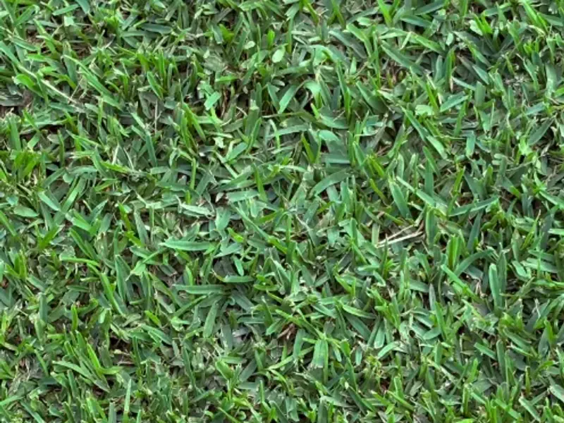
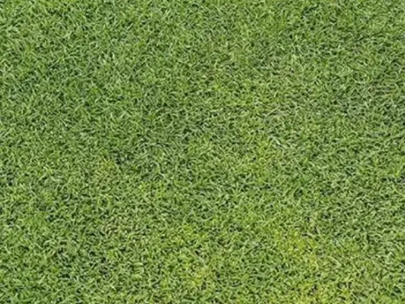
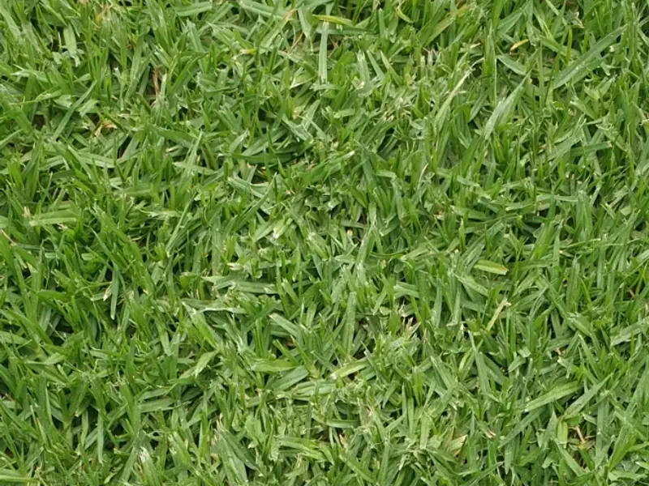

# Buffalo, Couch or Kikuyu: Choosing the Right Turf for a Melbourne Lawn

Most Melbourne home lawns are laid with one of three warm-season grasses: soft-leaf buffalo, couch or kikuyu. All three grow well here. They differ in how much shade they accept, how much wear they take, how they look through winter and how hard they try to grow into the garden beds.

There is no single best turf for every Melbourne yard. The right one depends on how many hours of direct sun the lawn gets, who uses it and how, and how much mowing and edging you are happy to keep up with.

## The short answer

- **Soft-leaf buffalo** suits most family yards, particularly where part of the lawn is shaded by the house, a fence or trees.
- **Couch** suits open, sunny lawns that get heavy use, where a fine and dense finish matters.
- **Kikuyu** suits large, sunny areas that take a beating and need to recover quickly, provided it has firm edges to keep it out of the garden.

## Buffalo, couch and kikuyu at a glance

| | Soft-leaf buffalo | Couch | Kikuyu |
|---|---|---|---|
| Sun | Full sun to part shade | Full sun | Full sun |
| Wear and recovery | Good wear, slower to repair | Very good, repairs quickly | Very good, repairs fastest |
| Leaf | Broad and soft | Fine and dense | Medium, fast-growing |
| Winter in Melbourne | Usually holds colour best, growth slows | Goes brown and dormant | Slows right down, can discolour after frost |
| Spread into beds | Above-ground runners | Runners and underground stems | Vigorous runners above and below ground |
| Summer mowing | Moderate | Frequent, lower cut for the best finish | Frequent |

## Soft-leaf buffalo: the family-lawn choice

Buffalo has a broad leaf, and the modern soft-leaf varieties are comfortable underfoot in a way older buffalo lawns were not. It wears well, copes with part shade better than couch or kikuyu, and generally needs mowing less often through summer.

The trade-off is recovery. Buffalo repairs worn patches more slowly than the other two, so a dog's favourite run along the fence or a goal mouth in the middle of the lawn can stay thin for longer. It spreads by above-ground runners, which are easier to keep out of garden beds than couch or kikuyu but still need a defined edge.

## Couch: full sun and hard wear

Couch has a fine, dense leaf that gives the most manicured finish of the three when it is mown low and often. It spreads both above and below ground, which is why it recovers so quickly from wear and is common on sports grounds.

It needs full sun. In a shaded corner couch thins out and weeds move in. It also goes brown and dormant through a Melbourne winter and greens up again as the soil warms in spring. Its underground stems can travel beneath shallow edging, so garden-bed edges need to be set deep enough to stop it.

## Kikuyu: tough, fast and hungry for space

Kikuyu is the most vigorous of the three. It repairs itself quickly, handles children, dogs and heavy traffic, and suits large, sunny backyards where a hard-working lawn matters more than a fine finish.

That vigour is also the main drawback. Kikuyu runs into garden beds, paving joints and neighbouring yards unless it is contained by firm, deep edging and trimmed regularly. It grows fast in warm weather, so expect frequent summer mowing, and it can look tired and discoloured through the coldest months.

## Shade decides more than anything else

Turf growers treat about six hours of direct sun a day as full sun. Before choosing, watch where the shadows fall, and remember that winter shadows from the house, fences and a double-storey next door reach much further than they do in summer.

Of these three, soft-leaf buffalo is the usual choice where part of the lawn is shaded. Couch and kikuyu will thin out. In heavy shade no natural turf performs well, and it is often better to plan for mulched planting, stepping stones or a synthetic surface in that section instead. Our guide to [natural vs synthetic turf](/blog/natural-vs-synthetic-turf-melbourne) covers that decision.

## Winter colour in Melbourne

All three are warm-season grasses, so they slow down from late autumn and pick up again in spring. Expect buffalo to stay greenest, couch to brown off and kikuyu to look patchy after frosty mornings. Winter browning is dormancy, and the lawn greens up again as the soil warms.

Timing matters too. Warm-season turf laid in the middle of winter can sit for weeks before it roots. Our article on the [best time to lay turf in Melbourne](/blog/best-time-to-lay-turf-melbourne) explains the spring and early-autumn windows and the watering rules for new lawns.

## Pets, children and heavy use

For a busy family yard, consider where the wear will actually happen. Couch and kikuyu recover quickest in a sunny lawn that is used every day. Buffalo is softer underfoot and the better fit for a shaded play area, but it will show wear for longer.

Concentrated traffic wears any lawn. A side gate, clothesline or back-door route that crosses the grass is often better served by a path, and our comparison of [pavers and stepping stones](/blog/pavers-vs-stepping-stones-garden-path) can help there. Dog urine marks all three varieties; rinsing favourite spots helps.

## Edges and ongoing care

All three spread, so every lawn needs a clear boundary with garden beds. Kikuyu and couch need the firmest and deepest edges, and buffalo needs a defined edge that is trimmed regularly. Beyond that, the routine is similar: mow at the right height for the variety, water deeply rather than often once the lawn is established, and feed through the growing season.

## Choose on site, not from a sample

A small piece of turf on a pallet tells you little about how it will grow in your yard. Sun hours, soil, drainage, levels and how the lawn will be used decide the variety, and good preparation decides whether any of them succeeds. Our article on [why new turf fails](/blog/why-new-turf-fails) explains what goes wrong when that part is rushed.

Sebastian can assess the area, recommend a variety for the sun and wear it will actually get, and handle the [natural turf installation](/services/natural-turf) from preparation to the first mow. To get started, [request a free quote](/quote) with the suburb, rough size and a few photos of the yard.
