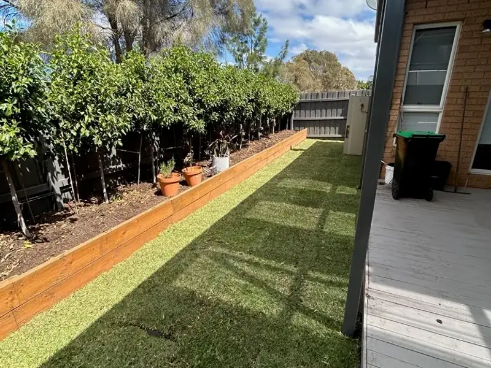
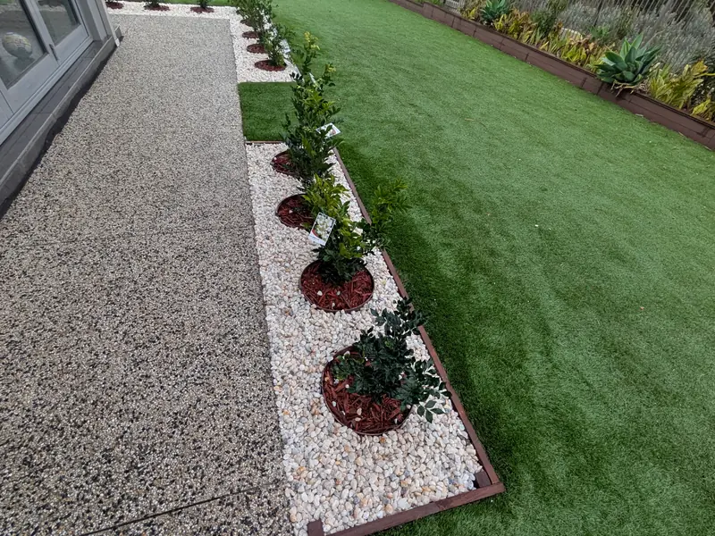

# How to Landscape a Narrow Side Yard in Melbourne

Most Melbourne homes have one: a strip of ground between the house and the fence that carries the bins, the meters, the taps and the route to the back gate. Left alone, it turns into a muddy track or a place to store whatever does not fit in the garage.

A side yard does not need to become a feature garden. It does need to be easy to walk, drain properly and look tidy from the windows that face it.

## Decide what the side yard is for

Start by listing everything that happens there. Common uses include:

- the route to the backyard for people, wheelbarrows and the mower;
- storing and wheeling out the bins;
- access to water, gas and electricity meters, the hot-water unit and air-conditioning plant;
- a clothesline or drying area; and
- the view from a bedroom window or sliding door.

Access usually comes first. Planting, lawn and decoration fit around it, not the other way round.

## Measure the clear width

Measure from the wall to the fence at the narrowest point, not the average. Downpipes, meter boxes, taps and air-conditioning units often take more room than expected. The path needs to stay wide enough for a wheelie bin or wheelbarrow at that narrowest point.

Leave meters and service points clear and reachable. Readers, plumbers and electricians need to get to them, and a garden bed built across a meter box will eventually be dug up.

## Choose a path that suits the traffic

The path is the main decision in most side yards.

- **Continuous paving or concrete** suits a route used every day, especially for bins on wheels.
- **Stepping stones** in gravel, pebbles or turf suit a lighter-use route and look less heavy in a narrow space.
- **Compacted gravel or toppings** are a practical, lower-cost surface where the ground drains well.

Our comparison of [pavers and stepping stones](/blog/pavers-vs-stepping-stones-garden-path) explains how each one performs underfoot, in wet weather and over time.

## When turf works in a side yard

A lawn can soften a side yard, but only when the conditions suit it. Turf needs enough direct sun, and it struggles where a path wears the same line every day.

The townhouse at the top of this article had a side yard wide and open enough for natural turf to run its full length. The ground was cleared, levelled and prepared first, so the lawn sits evenly against the house and fence.

In a shaded side yard, soft-leaf buffalo copes best of the three common warm-season varieties; our guide to [buffalo, couch and kikuyu](/blog/buffalo-couch-kikuyu-turf-melbourne) compares them. Where there is too little sun for any natural lawn, gravel, mulched planting or synthetic turf are the usual alternatives.

## Planting along a fence

Narrow beds work when the plants suit them. Choose upright, compact plants or climbers trained on wires rather than shrubs that spread across the path. Hedging in pots or behind a raised timber edge can screen a fence without taking much width.

Keep garden beds, mulch and soil well below the weep holes in the brickwork and clear of the slab edge. Building soil up against the house can let moisture and pests in where they should not be.

## Shade and drainage between buildings

Side yards are often the dampest part of a property. They collect water from downpipes, air-conditioning drains and sometimes the neighbour's yard, and there is little sun to dry them out.

The surface should fall away from the house towards a drainage point, and existing stormwater pits should stay visible and accessible rather than being buried under gravel or turf. Where water already pools, fix the levels and drainage before any finishes go down. Our article on [why new turf fails](/blog/why-new-turf-fails) shows what happens when turf goes down over ground that stays wet.

## Bins, taps and gates

A few small details make a side yard easier to live with:

- a firm, level pad for the bins close to the gate;
- a tap that can be reached without stepping into a garden bed;
- a gate wide enough for the mower and wheelbarrow; and
- a light at the house end, if the route is used after dark.

## Getting it quoted

When asking for a quote, send photos from both ends of the side yard, the width at its narrowest point and a note of what must stay accessible. That is usually enough for a useful first conversation.

Sebastian can look at the access, drainage and light, then suggest a layout through our [garden design service](/services/garden-design) that keeps the route practical and tidy. To start, [request a free quote](/quote).
