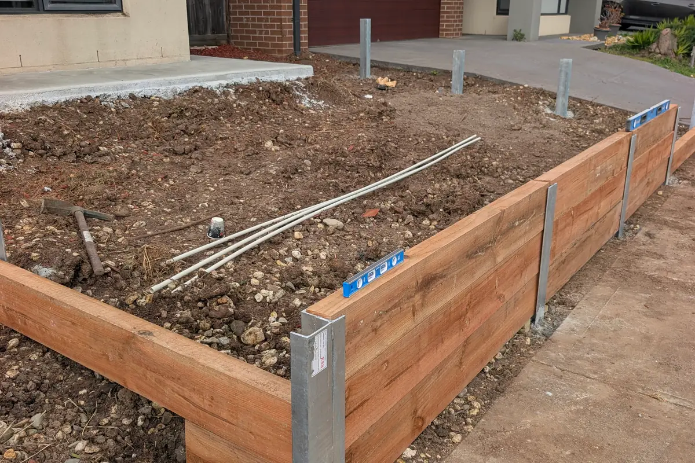
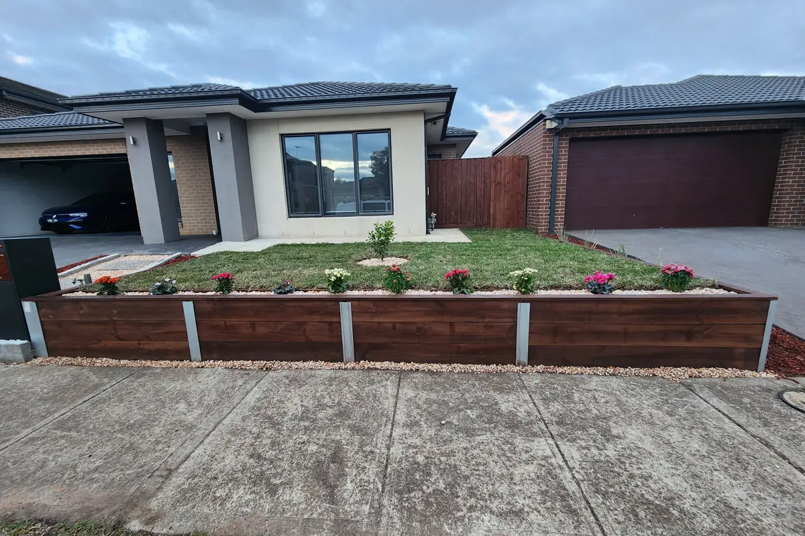

# Timber vs Concrete Sleeper Retaining Walls: What Changes the Decision?

Sleeper walls are among the most common garden retaining walls on Melbourne homes: horizontal sleepers slotted between steel posts set in concrete footings. The posts and footings do most of the structural work either way. The choice most owners face is the sleeper itself, timber or concrete.

Both work well when they are built properly. Height, drainage, the style of the house and how long you plan to stay usually decide it. If you are still working out whether you need a wall at all, start with [does your Melbourne yard need a retaining wall?](/blog/does-yard-need-retaining-wall-melbourne)

## The short answer

Timber sleepers suit lower walls, raised garden beds and projects where budget and a natural look come first. Concrete sleepers suit walls that hold back more soil, long boundary walls and owners who want the wall to outlast the rest of the garden with little upkeep.

## Side by side

| | Timber sleepers | Concrete sleepers |
|---|---|---|
| Upfront cost | Lower | Higher |
| Lifespan | Shorter; depends on treatment, drainage and soil contact | Longer, when well made and well drained |
| Look | Warm; can be stained or left to weather | Plain grey, or textured finishes such as woodgrain or stone |
| Upkeep | Check for decay; re-coat if stained | Little beyond keeping the drainage clear |
| Handling | Lighter, easy to cut on site | Heavy; site access and machinery matter |
| Curves and odd lengths | Easy to cut to suit | Made in set lengths, less flexible |

## Timber sleepers: the treatment matters

Most timber retaining walls use treated pine. Timber in contact with the ground should carry an in-ground hazard rating, H4 at a minimum and H5 where the wall is structural or the ground stays wet, and the treatment class should be confirmed before the sleepers arrive. Hardwood sleepers are another option where a heavier, darker timber suits the design.

Even well-treated timber eventually breaks down where it stays damp against soil, and the bottom sleeper usually goes first. Good drainage behind the wall extends its life considerably. A stain, like the dark finish on the wall at the top of this article, changes the look and adds a layer of protection, but it needs re-coating over the years.

## Concrete sleepers: quality varies

Concrete sleepers do not rot, are not attractive to termites and do not burn. They are reinforced with steel, and the quality of that reinforcement and of the concrete itself varies between manufacturers. Well-made sleepers stay straight for decades; poorly made ones can chip, crack or show rust staining.

They are also heavy. A long wall down a narrow side yard, where every sleeper goes in by hand, takes more time and labour than the same wall with open access for a small machine.

## Posts and footings matter most

Both systems rely on galvanised steel posts set in concrete footings. Post size, spacing and footing depth depend on the wall height, the soil and anything sitting above the wall, such as a driveway, fence or slope. A wall that leans after a few winters usually has undersized posts, shallow footings or poor drainage, not the wrong sleepers.

Concrete sleepers are heavier than timber, so the posts and footings must be designed for the product actually being used.

## Drainage behind the wall

Water is the main enemy of any retaining wall. A properly built sleeper wall has an agricultural drain behind the bottom course, free-draining gravel behind the sleepers and somewhere sensible for that water to go. For both, it relieves the water pressure that pushes walls over; for timber it also slows rot.

Runoff from roofs, paving and neighbouring yards should be considered at the same time, so the new wall does not create a wet area somewhere else.

## Height, permits and engineering

Taller walls, walls near a boundary or building, and walls carrying extra load can need a building permit and engineering in Victoria. Confirm the requirements for your property with the council or a building surveyor before work starts, and resolve them during planning rather than after excavation.

## How the wall sits with the house

Timber suits garden beds, warm-toned homes and gardens with plenty of planting. A dark stain works well against rendered, modern facades, as our [stained sleeper raised garden](/projects/stained-sleeper-raised-garden) at the top of this article shows. Concrete suits contemporary homes and long, straight runs, and woodgrain or stone finishes can soften its look. The posts can be left galvanised or painted to match.

## Questions to ask before you choose

- What treatment class are the timber sleepers, or who makes the concrete ones?
- What size are the posts, and how deep are the footings?
- How is the drainage handled, and where does the water discharge?
- Does the wall need a permit or engineering at this height and location?
- How will materials get to the wall if access is tight?

Sebastian can measure the site, explain which sleeper suits the height and loading, and build the wall through our [retaining wall service](/services/retaining-walls). To start, [request a free quote](/quote) with photos of the slope and its approximate length and height.
